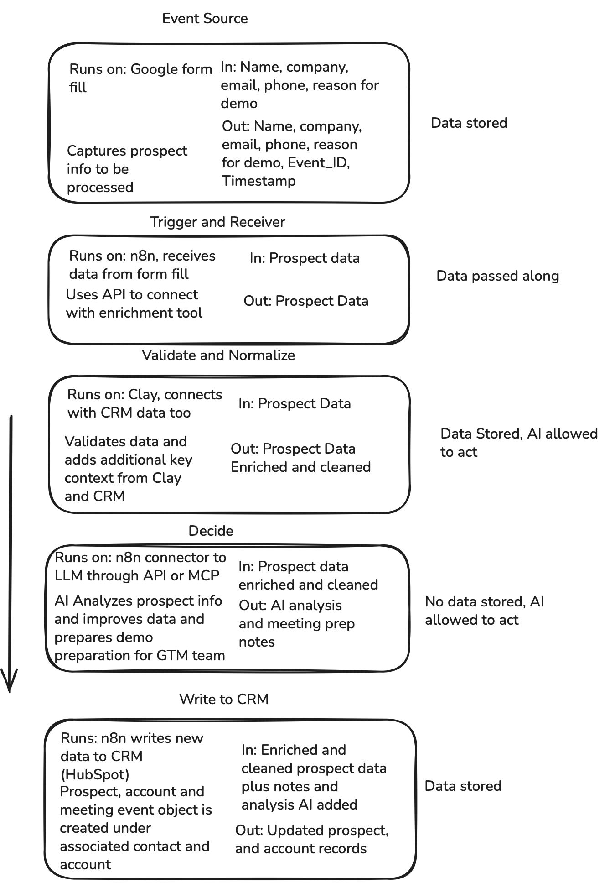

Okay, so I just created the diagram for how the process works for when someone fills out an inbound demo request. So the first step is going to be the event source, which passes data from the inbound form fill on the website. And what the visitor submits is their name, their company, their email address, as well as the reason for their demo and their phone number.

And we're going to use a webhook to connect this from the form to have N8N receive it every time someone fills it out. So it will be triggered from an action from the prospect, and it's going to convert the information into a JSON that then uploads it to or connects it to N8N using webhook.

And then N8N is going to be the receiver, which also passes data. It receives it in JSON and adds a run ID, which happens at every step, and then the third box is going to be validate, which...

Okay, so the validate box is the box that makes sure that all the data is properly inputted in the form and it makes sure that the email is correct and everything is properly formatted and if it's not formatted it reformats it and if the data is not up to the level that is acceptable like they're missing fields then it will move to some sort of review section that can be reviewed by someone, and it is not passed through to the next step. The next step being the enrich and decide.

So, this is where N8N will connect to Clay and it will enrich the data as well as connect to an LLM with an API call who will then ingest the data and add additional context, summarization, and meeting prep notes that will be passed along to the CRM later for the rep. Who's taken the call to utilize and in this box they're taking in a clean payload from the previous box which validated that everything was correct and didn't send anything bad through and leaving is the enriched payload.

Okay, so then this everything is properly enriched and validated here with good data and cleanly formatted so now it's finally ready to be sent to the CRM once everything is kosher. And this is again passed to N8N on a HubSpot node, which then searches for this specific person in the CRM to see if they exist.

If they exist, it will add this information to their contact page. If they don't exist, then it will create a new one, and if it is a duplicate, we can tell that by the event ID because each individual person has their own event ID. One event ID, it is not more than one.

If they submit the form multiple times, it will be the same event ID, so you can know it's a duplicate, and then you can map this all to the same contact. Whereas the run ID is different at each step, so you can debug it and understand what stuff is not working.

# Event-to-CRM architecture

This diagram shows how an inbound demo request travels from a website form to a contact in HubSpot.

## Box 1: Event source

A visitor submits the demo request form on the website with their name, company, email, phone number and reason for the demo. The form sends the data as JSON to an n8n webhook URL, so every submission triggers the workflow automatically. The payload includes an event_id and timestamp that identify this specific submission.

## Box 2: Receiver

An n8n Webhook node catches the JSON, responds to the form and starts the run. It adds one run_id to the payload. That same run_id is carried through every box, so a single run can be traced from start to finish when debugging. This box only passes data along.

## Box 3: Validate

n8n IF and Edit Fields nodes check that the data is usable: